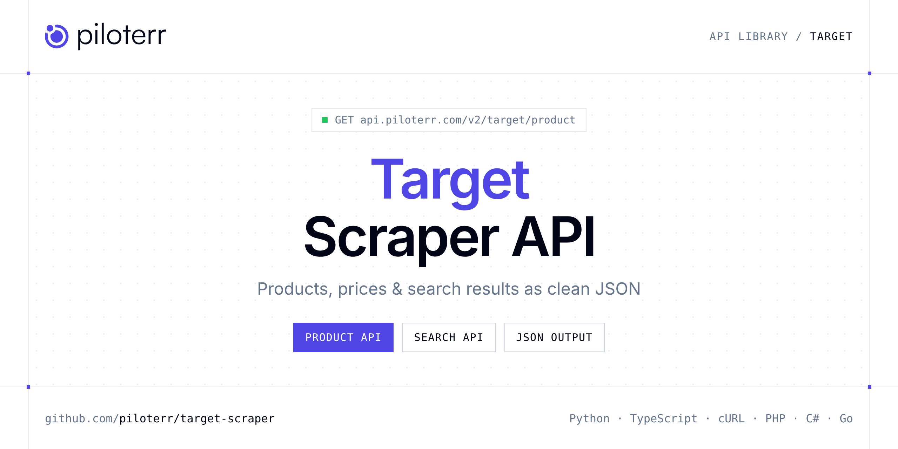

<p align="center">
  <a href="https://www.piloterr.com"></a>
</p>

# Target Scraper API

[](https://discord.gg/CFj3ph8aHU) [](https://app.piloterr.com) [](https://app.piloterr.com/openapi) [](LICENSE)

The **Piloterr Target Scraper API** lets you extract public data from Target as **clean, structured JSON** — no proxies, headless browsers or HTML parsing to maintain. Endpoints available in production:

- **Target Product API** — Get a Target.com product page: price, description, images and variations via browser rendering.
- **Target Search API** — Search Target.com by keyword or search URL.

Use it for price monitoring, assortment tracking, competitor analysis, product research or catalog enrichment.

| Endpoint | Path | Credits | What you get |
|---|---|---|---|
| [Target Product API](#target-product-api) | `/v2/target/product` | 2 | Get a Target.com product page |
| [Target Search API](#target-search-api) | `/v2/target/search` | 2 | Search Target.com by keyword or search URL. Returns product cards with price, rating and pagination via browser rendering. |

## Table of contents

- [How it works](#how-it-works)
- [Target Product API](#target-product-api)
- [Target Search API](#target-search-api)
- [Code examples in other languages](#code-examples-in-other-languages)
- [Practical use cases](#practical-use-cases)
- [Why Piloterr?](#why-piloterr)
- [FAQ](#faq)
- [Related scrapers](#related-scrapers)
- [Support](#support)

## How it works

1. **Create a free Piloterr account** and copy your API key from the [dashboard](https://app.piloterr.com).
2. **Send a `GET` (or `POST`) request** to `https://api.piloterr.com/v2/...` with the header `x-api-key: YOUR_API_KEY`.
3. **Receive structured JSON** — Piloterr handles rendering, proxies, retries and parsing.

```bash
export PILOTERR_API_KEY="your-api-key"
pip install requests        # Python
# TypeScript: Node.js 18+ (native fetch), run with `npx tsx file.ts`
```

> Every endpoint accepts both `GET` (query string) and `POST` (JSON body with the same fields).

## Target Product API

Get a Target.com product page: price, description, images and variations via browser rendering.

`GET | POST https://api.piloterr.com/v2/target/product` · **2 credits per request** · [Full reference](https://app.piloterr.com/openapi)

### Request parameters

| Parameter | Type | Required | Description |
|---|---|---|---|
| `query` | string | ✅ | Target product URL or bare TCIN. |
| `return_page_source` | boolean | — | When `true`, return rendered HTML instead of JSON. |

### Python example

```python
import json
import os
import requests

response = requests.get(
    "https://api.piloterr.com/v2/target/product",
    headers={"x-api-key": os.environ["PILOTERR_API_KEY"]},
    params={
        "query": "17457624",
    },
    timeout=60,
)
response.raise_for_status()
data = response.json()

print(json.dumps(data, indent=2, ensure_ascii=False)[:2000])
```

### TypeScript example

```typescript
type TargetProduct = {
  upc?: string;
  url?: string;
  dpci?: string;
  name?: string;
  tcin?: string;
  brand?: string;
  price?: number;
  images?: string[];
  rating?: number;
  currency?: string;
  ornaments?: string[];
  highlights?: string[];
  variations?: {
    url?: string;
    name?: string;
    tcin?: string;
    value?: string;
    selected?: boolean;
  }[];
  breadcrumbs?: {
    url?: string;
    name?: string;
  }[];
  description?: string;
  ingredients?: unknown;
  review_count?: number;
  bullet_descriptions?: string[];
};

const params = new URLSearchParams({
  "query": "17457624",
});

const response = await fetch(`https://api.piloterr.com/v2/target/product?${params}`, {
  headers: { "x-api-key": process.env.PILOTERR_API_KEY! },
});
if (!response.ok) throw new Error(`Piloterr error ${response.status}: ${await response.text()}`);

const data = (await response.json()) as TargetProduct;

console.log(JSON.stringify(data, null, 2).slice(0, 2000));
```

<details>
<summary><b>POST variant</b></summary>

```http
POST https://api.piloterr.com/v2/target/product
x-api-key: YOUR_API_KEY
Content-Type: application/json

{"query": "17457624"}
```
</details>

### Output example

Example response from the API reference, abridged — real values depend on the page you scrape.

```json
{
  "upc": "071249318553",
  "url": "https://www.target.com/p/l-oreal-paris-magic-root-cover-up-medium-brown-2-0oz/-/A-17457624",
  "dpci": "063-01-0615",
  "name": "L'Oreal Paris Magic Root Cover Up - Medium Brown - 2.0oz",
  "tcin": "17457624",
  "brand": "L'Oreal Paris",
  "price": 11.99,
  "images": [
    "https://target.scene7.com/is/image/Target/GUEST_2947578e-fc62-4731-a22a-42211a91cbe5"
  ],
  "rating": 4.02,
  "currency": "USD",
  "ornaments": [
    "Rarely returned",
    "Highly rated"
  ],
  "highlights": [
    "Conceals grays in seconds for flawless roots",
    "Lightweight formula, no smudging or sticky residue"
  ],
  "variations": [
    {
      "url": "https://www.target.com/p/l-oreal-paris-magic-root-cover-up-medium-brown-2-0oz/-/A-17457624",
      "name": "Color",
      "tcin": "17457624",
      "value": "Medium Brown",
      "selected": true
    },
    {
      "url": "https://www.target.com/p/l-oreal-paris-magic-root-cover-up-black-2-0oz/-/A-17457618",
      "name": "Color",
      "tcin": "17457618",
      "value": "Black",
      "selected": false
    }
  ],
  "breadcrumbs": [
    {
      "url": "https://www.target.com/",
      "name": "Target"
    },
    {
      "url": "https://www.target.com/c/beauty/-/N-55r1x",
      "name": "Beauty"
    }
  ],
  "description": "Temporary hair color spray to cover gray roots in seconds. Ammonia-free and sulfate-free.",
  "ingredients": null,
  "review_count": 7057,
  "bullet_descriptions": [
    "Hair Type: All Hair Types",
    "Product Form: Aerosol"
  ]
}
```

### Response fields

| Field | Type | Description |
|---|---|---|
| `upc` | string |  |
| `url` | string |  |
| `dpci` | string |  |
| `name` | string |  |
| `tcin` | string |  |
| `brand` | string |  |
| `price` | number |  |
| `images` | string[] |  |
| `rating` | number |  |
| `currency` | string |  |
| `ornaments` | string[] |  |
| `highlights` | string[] |  |
| `variations[]` | object[] |  |
| `variations[].url` | string |  |
| `variations[].name` | string |  |
| `variations[].tcin` | string |  |
| `variations[].value` | string |  |
| `variations[].selected` | boolean |  |
| `breadcrumbs[]` | object[] |  |
| `breadcrumbs[].url` | string |  |
| `breadcrumbs[].name` | string |  |
| `description` | string |  |
| `ingredients` | object |  |
| `review_count` | integer |  |
| `bullet_descriptions` | string[] |  |

## Target Search API

Search Target.com by keyword or search URL. Returns product cards with price, rating and pagination via browser rendering.

`GET | POST https://api.piloterr.com/v2/target/search` · **2 credits per request** · [Full reference](https://app.piloterr.com/openapi)

### Request parameters

| Parameter | Type | Required | Description |
|---|---|---|---|
| `query` | string | ✅ | Keyword or Target search URL. |
| `page` | string | — | Page number (1-based). |
| `return_page_source` | boolean | — | When `true`, return rendered HTML instead of JSON. |

### Python example

```python
import json
import os
import requests

response = requests.get(
    "https://api.piloterr.com/v2/target/search",
    headers={"x-api-key": os.environ["PILOTERR_API_KEY"]},
    params={
        "query": "shampoo",
    },
    timeout=60,
)
response.raise_for_status()
data = response.json()

print(json.dumps(data, indent=2, ensure_ascii=False)[:2000])
```

### TypeScript example

```typescript
type TargetSearch = {
  results?: {
    url?: string;
    name?: string;
    tcin?: string;
    brand?: string;
    price?: number;
    rating?: number;
    currency?: string;
    image_url?: string;
    sponsored?: boolean;
    review_count?: number;
  }[];
  pagination?: {
    next?: string;
    page?: number;
    per_page?: number;
    total_pages?: number;
    total_results?: number;
  };
};

const params = new URLSearchParams({
  "query": "shampoo",
});

const response = await fetch(`https://api.piloterr.com/v2/target/search?${params}`, {
  headers: { "x-api-key": process.env.PILOTERR_API_KEY! },
});
if (!response.ok) throw new Error(`Piloterr error ${response.status}: ${await response.text()}`);

const data = (await response.json()) as TargetSearch;

console.log(JSON.stringify(data, null, 2).slice(0, 2000));
```

<details>
<summary><b>POST variant</b></summary>

```http
POST https://api.piloterr.com/v2/target/search
x-api-key: YOUR_API_KEY
Content-Type: application/json

{"query": "shampoo"}
```
</details>

### Output example

Example response from the API reference, abridged — real values depend on the page you scrape.

```json
{
  "results": [
    {
      "url": "https://www.target.com/p/l-oreal-paris-magic-root-rescue-10-minute-root-hair-coloring-kit/-/A-54397299",
      "name": "L'Oreal Paris Magic Root Rescue 10 Minute Root Hair Coloring Kit",
      "tcin": "54397299",
      "brand": "L'Oreal Paris",
      "price": 6.99,
      "rating": 4,
      "currency": "USD",
      "image_url": "https://target.scene7.com/is/image/Target/GUEST_c22ac354-59d7-4187-ab0b-8cd8a4707e07?qlt=65&fmt=webp&hei=350&wid=350",
      "sponsored": true,
      "review_count": 1525
    }
  ],
  "pagination": {
    "next": "https://www.target.com/s?searchTerm=root+touch+up+hair+dye&Nao=24",
    "page": 1,
    "per_page": 24,
    "total_pages": 9,
    "total_results": 201
  }
}
```

### Response fields

| Field | Type | Description |
|---|---|---|
| `results[]` | object[] |  |
| `results[].url` | string |  |
| `results[].name` | string |  |
| `results[].tcin` | string |  |
| `results[].brand` | string |  |
| `results[].price` | number |  |
| `results[].rating` | integer |  |
| `results[].currency` | string |  |
| `results[].image_url` | string |  |
| `results[].sponsored` | boolean |  |
| `results[].review_count` | integer |  |
| `pagination` | object |  |
| `pagination.next` | string |  |
| `pagination.page` | integer |  |
| `pagination.per_page` | integer |  |
| `pagination.total_pages` | integer |  |
| `pagination.total_results` | integer |  |

## Code examples in other languages

Ready-to-run examples live in the [`examples/`](examples) folder. Each one reads your key from the `PILOTERR_API_KEY` environment variable.

| Language | Product | Search |
|---|---|---|
| cURL (Bash) | [`product`](examples/curl/product.sh) | [`search`](examples/curl/search.sh) |
| PHP | [`product`](examples/php/product.php) | [`search`](examples/php/search.php) |
| C# | [`product`](examples/csharp/Product.cs) | [`search`](examples/csharp/Search.cs) |
| Go | [`product`](examples/go/product.go) | [`search`](examples/go/search.go) |
| Java | [`product`](examples/java/ProductExample.java) | [`search`](examples/java/SearchExample.java) |
| Ruby | [`product`](examples/ruby/product.rb) | [`search`](examples/ruby/search.rb) |
| Node.js | [`product`](examples/nodejs/product.mjs) | [`search`](examples/nodejs/search.mjs) |

## Practical use cases

- **Price monitoring** — Track prices, promotions and availability over time to react to competitors.
- **Assortment & catalog tracking** — Follow new products, delisted items and category changes.
- **Competitor analysis** — Benchmark ranges, brands and positioning across retailers.
- **Product research** — Spot best-sellers and trends from search results.
- **Catalog enrichment** — Pull titles, images and attributes into your PIM or marketplace listings.

## Why Piloterr?

- **No infrastructure** — no proxies, headless browsers or CAPTCHA solving to run yourself.
- **Structured JSON** — stable, documented fields instead of brittle HTML selectors.
- **Pay per request** — transparent credit cost per endpoint, failed requests are retried for you.
- **One API key, hundreds of sources** — Target plus many other e-commerce, search and company data endpoints in the [Piloterr library](https://www.piloterr.com/library).
- **Any language** — plain HTTPS + JSON, with examples for Python, TypeScript, cURL, PHP, C#, Go, Java, Ruby and Node.js.

## FAQ

### Is it legal to scrape Target?

Collecting publicly available data is generally allowed in many jurisdictions, but rules depend on your country, the data you collect and how you use it. Avoid personal data unless you have a lawful basis, respect the website's terms where they apply, and get legal advice for your specific use case. This is not legal advice.

### Do I need proxies or a headless browser?

No. Piloterr handles rendering, proxy rotation and retries on its side. You only send an HTTPS request with your `x-api-key` header and receive JSON.

### How much does a request cost?

Credits per call: `/v2/target/product` **2**, `/v2/target/search` **2**. See the [Piloterr website](https://www.piloterr.com) for plans.

### What data does the Target API return?

Each endpoint returns structured JSON: **Target Product** — `upc`, `url`, `dpci`, `name`, `tcin`, `brand`; **Target Search** — `results[]`, `results[].url`, `results[].name`, `results[].tcin`, `results[].brand`, `results[].price`.

### How do I paginate Target results?

Use the `page` parameter and keep requesting while the response indicates more results.

### Can I get the raw HTML instead of JSON?

Yes. Set `return_page_source=true` and the response becomes `{"result": "..."}` with the page source.

### Which languages are supported?

Any language that can make an HTTP request. This README shows Python and TypeScript; the [`examples/`](examples) folder contains cURL, PHP, C#, Go, Java, Ruby and Node.js.

## Related scrapers

- [About You Scraper API](https://github.com/piloterr/aboutyou-scraper)
- [Action Scraper API](https://github.com/piloterr/action-scraper)
- [Aldi Scraper API](https://github.com/piloterr/aldi-scraper)
- [Alibaba Scraper API](https://github.com/piloterr/alibaba-scraper)
- [AliExpress Scraper API](https://github.com/piloterr/aliexpress-scraper)
- [Allegro Scraper API](https://github.com/piloterr/allegro-scraper)
- [All Piloterr scrapers on GitHub](https://github.com/piloterr)

## Support

- 💬 Join the [Piloterr Discord](https://discord.gg/CFj3ph8aHU) to ask questions and share what you build.
- 📚 Browse the [API reference (OpenAPI)](https://app.piloterr.com/openapi) and the [Piloterr library](https://www.piloterr.com/library).
- 🔑 [Get your API key](https://app.piloterr.com).

---

<p align="center">
  <a href="https://www.piloterr.com">
    <picture>
      <source media="(prefers-color-scheme: dark)" srcset="images/logo-dark.svg">
      
    </picture>
  </a>
  <br>
  <sub>Built by <a href="https://www.piloterr.com">Piloterr</a> — web scraping APIs for e-commerce, search, real estate and more, one API key.</sub>
</p>

<sub>Target is a trademark of its respective owner. This repository is not affiliated with or endorsed by Target. Examples are released under the MIT license.</sub>
